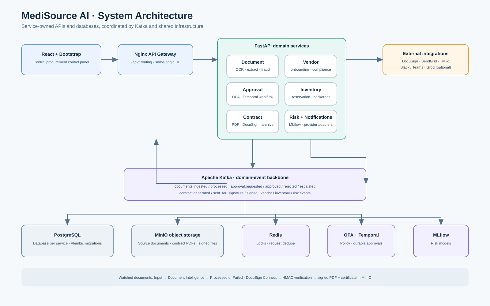

# MediSource AI Project Overview

## Introduction

MediSource AI is a procurement operations platform for healthcare organizations. It brings supplier documents, vendor records, approvals, inventory, risk, notifications, contracts, and electronic signatures into one web control panel.

## Objectives and scope

- Reduce manual work in document review and purchasing approvals.
- Keep an auditable record of extracted values, decisions, notifications, and contract events.
- Show operational status and exceptions from a centralized interface.
- Support local development with Docker Compose and a Kubernetes deployment for a cluster.

The current project covers document upload and watched-folder ingestion, OCR and extraction, vendor onboarding, OPA-based approval routing, Temporal approval workflows, inventory reservations, supplier risk scoring, contract generation, OpenSign integration, and multi-channel notification adapters. Email/SMS/chat delivery and OpenSign signing require valid provider credentials and endpoint configuration.

## Architecture

The React/Bootstrap control panel calls FastAPI services through Nginx. PostgreSQL databases are owned per service; Kafka carries cross-service events. MinIO stores source and contract PDFs. Redis supports locks and deduplication. Temporal runs durable approval workflows. OPA supplies policy decisions, and MLflow tracks risk model runs.

See Architecture for service responsibilities, event topics, and implementation details. API schemas and topic names are documented in SCHEMA.md.

## Functional capabilities

| Area | Implemented behavior |
|---|---|
| Document management | Uploads and watched-folder files enter Input; the Kafka worker processes documents; successful files move to Processed; failures move to Failed with a reason sidecar and database error. Failed documents can be retried from the CPanel. |
| Document intelligence | OCR text, extracted fields, field-level confidence, document confidence, fraud signals, missing fields, and manual corrections are visible in the review panel. |
| Vendor management | Vendor onboarding and profile records include contact and compliance information used by approval and signature workflows. |
| Approvals | OPA selects approver chains; Temporal waits for decisions and records escalation and outcomes. Approval-request notifications route to role addresses configured in APPROVER_EMAILS. |
| Notifications | The CPanel supports template creation, viewing, editing, and deletion, including recipient, subject, body, and Jinja placeholders. Approval outcomes fan out to requester email (when provided) and vendor contact email. Delivery state distinguishes sent, simulated, and failed; provider readiness is visible without exposing secrets, and new delivery failures retain their provider diagnostic. Placeholder credentials are treated as simulated. |
| Contracts and e-signature | Approval generates a PDF contract, sends it through OpenSign when configured, tracks the provider envelope and signing URL, and accepts signed/declined webhooks. A verified completion event stores the signed PDF and certificate in MinIO and exposes a CPanel download link. |
| Inventory and risk | Inventory reservations/backorders and supplier risk scores/anomalies are available as separate control-panel work areas. Invalid or missing GSTIN values produce a compliance-risk floor and remain a visible KYC hold independently of the model band. |
| Administration and operations | The CPanel exposes document, approval, inventory, contract, notification, risk, vendor, and event/log views with role-aware actions and service connection alerts. |

## Document lifecycle

Place supported PDFs or images under watched_documents/Input. The watcher stores the bytes in MinIO, creates a document record, and publishes documents.ingested. The consumer displays processing while OCR and extraction run. A successful result moves the source file to Processed; an exception records failed, an error message, and a sidecar under Failed. Operators can retry failed records from Document Intelligence.

## E-signature configuration

Set OPENSIGN_BASE_URL and OPENSIGN_API_KEY to an OpenSign API endpoint and token. Set OPENSIGN_WEBHOOK_SECRET to the OpenSign webhook authentication key, and register the public URL /api/contracts/webhooks/opensign with OpenSign. OPENSIGN_FILE_HOSTS must include the HTTPS host suffixes that OpenSign uses for signed PDFs and certificates. The webhook verifies HMAC-SHA256 before accepting an event; only a completed event marks the contract signed and exposes its stored PDF.

Without provider credentials, the application records a configuration error instead of presenting an unsigned or simulated document as signed. An explicit ESIGN_DEMO_MODE=true creates a clearly labelled demo envelope only; it does not create a real signature.

## Notification configuration

Configure APPROVER_EMAILS as a JSON map from approver role to email address. Add provider credentials for SendGrid, Twilio, Slack, or Teams to deliver notifications. Without provider settings, the platform logs the message and records it as simulated; that status is visible in the notification dashboard and is not represented as delivered.

## Deployment and operation

### Docker Compose

1. Copy .env.example to .env and replace development credentials.
2. Set provider credentials and approver email mappings for a live integration.
3. Start the stack with docker compose up --build.
4. Open the frontend at the configured port (default http://localhost:3000).
5. Monitor service health and the CPanel event/notification panels.

### Kubernetes

Apply the manifests in k8s/ in namespace medisource. document-intelligence.yaml requests a ReadWriteMany PVC for the shared Input/Processed/Failed folders because the document service has multiple replicas. The cluster must provide a storage class that supports RWX. Configure OpenSign and notification secrets with a secret manager before live use.

## Testing and verification

The frontend production build passes with `npm run build`. Python services compile with `python -m compileall -q services`, and `git diff --check` passes. Nine focused unit tests cover contract PDF/signature-provider behavior, notification delivery-state reporting, and GSTIN compliance scoring. These checks do not replace an application-wide integration or end-to-end test suite. Full runtime verification requires Docker/Compose or a Kubernetes cluster, PostgreSQL, Kafka, MinIO, Temporal, OPA, and real provider credentials for live email and e-signature delivery.

## Results and limitations

- The project has an end-to-end event architecture and a single CPanel, with visible document and e-signature states.
- Successful external delivery and signature completion cannot be claimed until OpenSign and notification credentials are configured and their callbacks are exercised against the running deployment.
- The event-stream workflow preview is illustrative only. It creates no records, sends no notifications, and does not demonstrate a live document-to-signature transaction.
- Kubernetes watched-folder persistence requires RWX storage; behavior depends on the cluster's storage class.
- Document upload through email and external APIs is represented through the service ingestion interfaces and event simulation; live mail/ERP connectors are deployment integrations.
- This repository does not include a functional flowchart or MkDocs site, per the requested scope.

## Future enhancements

- Add automated service-level integration tests against ephemeral PostgreSQL, Kafka, MinIO, Temporal, and OPA.
- Add an outbox/retry policy for Kafka publication failures and delivery retry queues for provider outages.
- Add OIDC authentication and fine-grained user identity mapping for requester and approver notifications.
- Exercise OpenSign sandbox signing and provider webhook delivery in a deployed environment.
